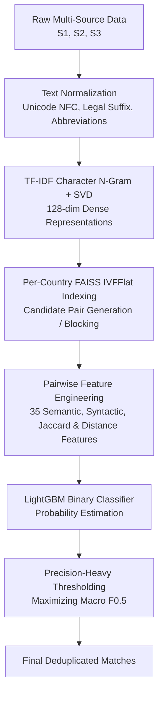

# Amazon ML Challenge 2026: Business Entity Resolution

[](https://www.python.org/downloads/)
[](https://opensource.org/licenses/MIT)

> **Team Name:** Anonymous_Coders  
> **Challenge:** Amazon ML Challenge 2026 — Business Entity Resolution  
> **Approach:** Two-stage Entity Resolution Pipeline (TF-IDF + SVD + FAISS Blocking + LightGBM Pairwise Classification)

---

## 📌 Problem Overview

In large-scale commercial platforms, business identity data arrives from multiple independent sources (`Source 1`, `Source 2`, `Source 3`) — each contributing partial, noisy fragments of information without common identifiers. The objective is to identify all matching records across `Source 2` and `Source 3` corresponding to each `Source 1` reference entity under open-world conditions (including unseen countries such as France).

Key Evaluation Metric: **$F_{0.5}$ score** (precision-heavy, where false positive merges are penalized 4× more heavily than false negatives).

---

## 🚀 Solution Architecture



1. **Text Normalization**: Legal suffix standardization, multilingual abbreviation expansion, and Unicode NFC normalization.
2. **Dense Representation & Blocking**: Character 2-4-gram TF-IDF vectorizer + 128-dimensional Truncated SVD, indexed with per-country FAISS IVFFlat to rapidly extract top candidate pairs.
3. **Feature Engineering**: 35 hand-crafted pairwise features (Jaccard, Levenshtein, token overlap, address/country consistency, embedding cosines).
4. **Ranking & Classification**: LightGBM model trained on ground truth pairs with tuned decision threshold to optimize $F_{0.5}$.

---

## 📁 Repository Structure

```text
├── .gitignore
├── README.md
└── 6ab10eb3b23ba_student_resource(Data-Set)/
    └── student_resource/
        ├── README.md
        ├── Documentation_template.md
        ├── .cache/
        │   └── model/
        │       ├── config.json
        │       └── lgbm_model.pkl
        ├── code/
        │   └── business_entity_resolution/
        │       ├── README.md
        │       ├── requirements.txt
        │       └── src/
        │           ├── blocking.py
        │           ├── fast_rescore.py
        │           ├── features.py
        │           ├── normalize.py
        │           ├── pipeline.py
        │           ├── scorer.py
        │           └── train_and_tune.py
        ├── scratch/
        │   ├── fast_filter_matches.py
        │   ├── package_submission.py
        │   ├── sweep_higher_thresholds.py
        │   ├── test_fast_scoring_bench.py
        │   └── verify_fast_features.py
        └── utils/
            ├── package_submission.py
            └── validate_submission.py
```

> **Note on Data:** Raw dataset tables (`*.tsv`), full candidate pair dumps, and temporary intermediate cache files (`*.pkl`) are excluded from Git tracking via `.gitignore` in accordance with competition file size limits. Place competition dataset files under `dataset/train/` and `dataset/test/` to reproduce runs.

---

## ⚙️ Installation & Usage

### 1. Install Dependencies
```bash
pip install -r "6ab10eb3b23ba_student_resource(Data-Set)/student_resource/code/business_entity_resolution/requirements.txt"
```

### 2. Run Pipeline
```bash
python "6ab10eb3b23ba_student_resource(Data-Set)/student_resource/code/business_entity_resolution/src/pipeline.py"
```

### 3. Validate Submission
```bash
python "6ab10eb3b23ba_student_resource(Data-Set)/student_resource/utils/validate_submission.py"
```
